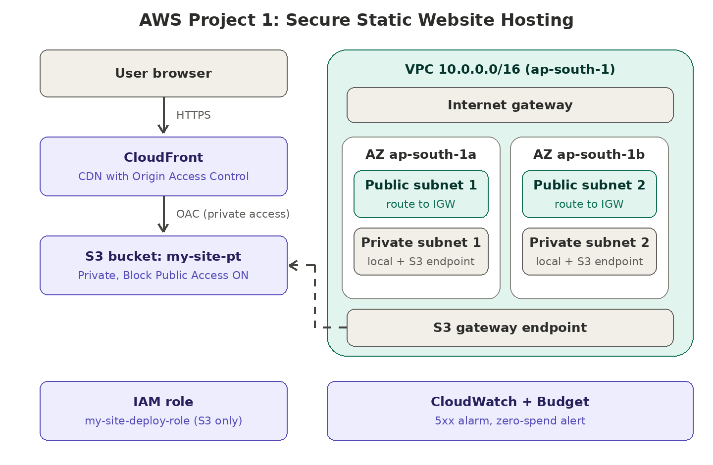

# Project 1: Host a Website on AWS

A static website hosted the way a real team would do it: private storage, a CDN in front, least-privilege access, a custom VPC, and monitoring.

**Live URL:** `https://<your-distribution>.cloudfront.net` (add after CloudFront is live)

## How it works

1. A visitor opens the site over **HTTPS** through **CloudFront**.
2. CloudFront reads the files from a **private S3 bucket** using **Origin Access Control (OAC)**. The bucket has Block Public Access turned on, so the only way to reach the files is through CloudFront.
3. A custom **VPC** is built as the network foundation. The static site itself is served by S3 and CloudFront, which are not VPC resources.
4. **IAM** gives only the permissions needed. **CloudWatch** and **AWS Budgets** watch for errors and cost.

## Services and why I chose them

| Service | What I used it for | Why |
|---|---|---|
| S3 | Stores the website files | Cheap, durable, no server to manage |
| CloudFront | Serves the site over HTTPS | Caching near visitors, free HTTPS certificate, hides the bucket |
| OAC | Lets only CloudFront read the bucket | Bucket stays private, no public access |
| VPC | Custom network `10.0.0.0/16` | Shows networking skills: subnets, routing, gateways |
| IAM | Admin user, deploy policy and role | No root usage, least privilege, no hard-coded keys |
| CloudWatch | Alarm on CloudFront 5xx errors | Know about problems before visitors do |
| AWS Budgets | Zero-spend alert | Get emailed if any cost appears |
| Route 53 + ACM | Not used (custom domain is optional) | CloudFront's default URL already provides HTTPS |

## What I built

### 1. Account security
- Enabled MFA on the root user and stopped using it.
- Created an IAM admin user (with MFA) for daily work.

### 2. VPC (`ap-south-1`)
- CIDR `10.0.0.0/16`, 2 Availability Zones.
- 2 public subnets and 2 private subnets.
- Public route table has `0.0.0.0/0` pointing to the **Internet Gateway**. Private route tables have no internet route.
- Free **S3 gateway endpoint** for private access to S3.
- No NAT gateway (it costs money and this project doesn't need it).

### 3. S3 + CloudFront
- Private S3 bucket `my-site-pt` with Block Public Access ON.
- CloudFront distribution with OAC and default root object `index.html`.
- Bucket policy allows only the CloudFront service to read objects.

### 4. IAM
- Policy `my-site-deploy-policy` allows only list, get, put and delete on the site bucket (see `my-site-deploy-policy.json`).
- Role `my-site-deploy-role` uses that policy. Roles give temporary credentials, so there are no access keys to leak.

### 5. Monitoring and cost
- CloudWatch alarm on the CloudFront 5xx error rate.
- Zero-spend budget that emails me when any cost appears.

## Security decisions

- Root user locked with MFA and not used.
- S3 bucket is never public.
- IAM policy scoped to one bucket, not `s3:*` on `*`.
- Roles instead of access keys.
- Paid add-ons (WAF) intentionally left off to stay free-tier friendly.

## Interview notes

**Public vs private subnet?**
A subnet is public when its route table sends `0.0.0.0/0` to an Internet Gateway. A private subnet has no such route, so it can't be reached from the internet.

**How does CloudFront cache content?**
CloudFront keeps copies of files at edge locations close to visitors. On the first request it fetches from the origin (S3) and stores the file. Later requests are served from the edge until the TTL expires or the cache is invalidated.

**Why use an IAM role instead of access keys?**
Roles give temporary credentials that rotate automatically. Access keys are long-lived secrets that can leak (for example, committed to GitHub).

**Security group vs NACL?**
A security group is stateful and works at the instance level (allow rules only). A NACL is stateless and works at the subnet level (allow and deny rules, evaluated in order).

## Repo contents

- `README.md`: this file
- `architecture.png`: architecture diagram
- `my-site-deploy-policy.json`: IAM policy
- `index.html`: the website

## Cost

Everything here runs on free-tier or free-by-design services. The only paid items I avoided were NAT gateways, WAF and a custom domain.

## What I would add next

- Custom domain with Route 53 and an ACM certificate.
- Automated deploys (GitHub Actions) using an IAM role.
- WAF rules for production traffic.
- Infrastructure as code (Terraform or CloudFormation).
